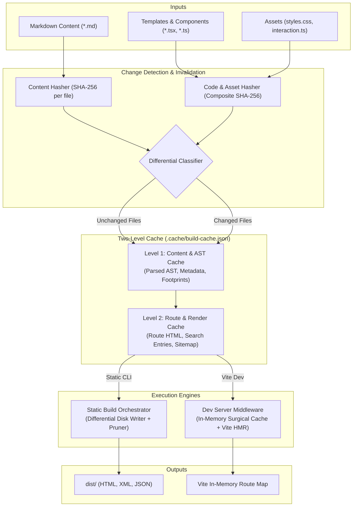

# Architecture Design: Incremental Build System

## 1. Executive Summary & Problem Statement

The bloatware site generator currently runs a full linear $O(N)$ rebuild on every invocation:
- **Static Build (`npm run build`)**: Deletes the entire `dist/` directory, discovers and parses all markdown files from scratch, re-renders every React route through `renderToStaticMarkup`, re-bundles all assets, and rewrites every file to disk (taking ~3.8s for 35 routes).
- **Dev Server (`npm run dev`)**: Every file change (even a single typo in a markdown file) triggers a full route hierarchy reconstruction and re-renders all 35 routes in memory (taking ~2.5s), causing noticeable latency during content editing.

This design introduces a high-performance **Two-Level Incremental Build Architecture** that guarantees fast, deterministic builds for both:
1. **Incremental Static Builds**: Instant skip if unchanged (~30ms), or differential disk I/O rendering only modified routes and pruning deleted pages.
2. **Incremental Dev Server (HMR)**: Surgical in-memory cache update when a markdown file is touched (~5–15ms), skipping full re-parsing and re-rendering of unaffected routes.

---

## 2. Architecture Overview

---

## 3. Two-Level Caching Model

### Level 1: Content & AST Cache (`ContentCache`)
- **Key**: Relative file path (e.g. `content/articles/2026/03/the-fuel-of-intent.md`, `readMe.md`).
- **Cached Data**:
  - `hash`: SHA-256 hash of file content.
  - `mtimeMs`: Last modified timestamp (for fast pre-check).
  - `rawRecord`: `{ kind, sourcePath, absolutePath, ast, metadata }`.
  - `searchData`: Extracted `{ headings, content }` for search indexing.
- **Invalidation Rule**: If file hash matches, reuse the parsed AST directly from memory/cache without running `parseMarkdown` or reading disk again.

### Level 2: Route & Render Cache (`RouteCache`)
- **Key**: Canonical route string (e.g. `/articles/2026/03/the-fuel-of-intent/`, `/`, `/articles/`).
- **Cached Data**:
  - `route`: Route path.
  - `html`: Pre-rendered HTML markup.
  - `htmlHash`: SHA-256 of rendered HTML.
  - `dependencies`: List of content IDs, series keys, or collection tokens it depends on.
  - `sitemapEntry`: Cached sitemap metadata (`priority`, `changefreq`, `lastmod`).
- **Invalidation Rule**:
  - If a route's dependencies have not changed and code hash is identical, the cached HTML is reused without invoking React's `renderToStaticMarkup`.

---

## 4. Invalidation Semantics & Dependency Matrix

| Event | Affected Scope | Re-parse Scope | Re-render Scope | Static Output Action |
| :--- | :--- | :--- | :--- | :--- |
| **Markdown Modified** | Single content item | Only modified file | Detail route + Parent collection + Home (if in recent) | Overwrite modified HTML files; update search index & sitemap |
| **Markdown Added** | New content item | Only new file | New detail route + Parent collection + Home | Write new HTML file; update search index & sitemap |
| **Markdown Deleted** | Deleted content item | None (remove from cache) | Parent collection + Home | Delete orphaned HTML file/dir from `dist/`; update index |
| **`readMe.md` Modified** | Homepage intro | Only `readMe.md` | Home route (`/`) only | Overwrite `dist/index.html` |
| **Template/Component (`.tsx`) Modified** | All UI routes | None (ASTs reused!) | All routes | Re-render and overwrite all HTML files |
| **CSS / Client JS Modified** | Assets | None | Re-bundle assets only | Write `dist/assets/`, update inline CSS in HTML |

---

## 5. Incremental Static Build Workflow

1. **Check CLI Flags**: If `--clean` is passed or `dist/` is missing, perform a full clean build.
2. **Compute Hashes**:
   - Compute code hash across `site/src/`, `site/modules/`, `site/scripts/`.
   - Scan markdown files and compute content hashes.
3. **Classify Changes**:
   - Compare with cached manifest (`site/.cache/build-cache.json`).
   - Categorize into `added`, `modified`, `deleted`, `unchanged`.
4. **Conditional Execution**:
   - **Zero Changes**: If code and all content files are unchanged and `dist/` is intact, exit immediately:
     `[build-static] Build up to date (0 routes rebuilt) in 28ms.`
   - **Code Changed**: Re-render all routes using cached ASTs (no markdown re-parsing), re-bundle assets, write HTML.
   - **Content Changed**:
     - Parse only `added` and `modified` files.
     - Compute changed routes.
     - Re-render only changed detail routes and invalidated collection routes.
     - Write only changed HTML files to `dist/`.
     - Delete orphaned HTML paths for `deleted` routes.
     - Write updated `search-index.json` and `sitemap.xml`.
5. **Persist Cache**: Write updated cache manifest to `site/.cache/build-cache.json`.

---

## 6. Incremental Dev Server Workflow

1. **Startup**:
   - Loads cached ASTs and routes from disk if available, or does a fast initial parse.
   - Builds initial in-memory route map.
2. **File Watcher (`handleHotUpdate`)**:
   - **Single Markdown Touched**:
     - Extract path and compute new hash.
     - Parse ONLY that single markdown file via `parseMarkdown`.
     - Update Level 1 cache entry.
     - Update article series metadata (if article).
     - Invalidate only its detail route and affected index routes (`/articles/`, `/`).
     - Re-render only those 2–3 routes into memory.
     - Update in-memory search index entry.
     - Rebuild takes **< 15ms** instead of 2500ms.
     - Trigger Vite HMR / reload.
   - **Template/TSX Touched**:
     - Invalidate Level 2 route cache.
     - Re-render routes in memory using existing cached ASTs (no re-parsing).
     - Trigger full-reload.
